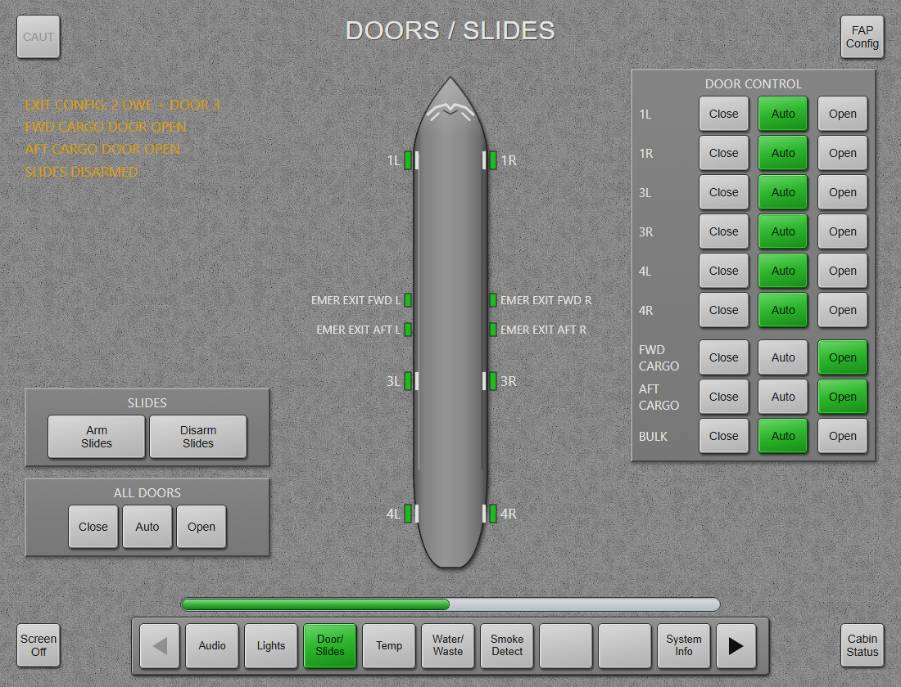
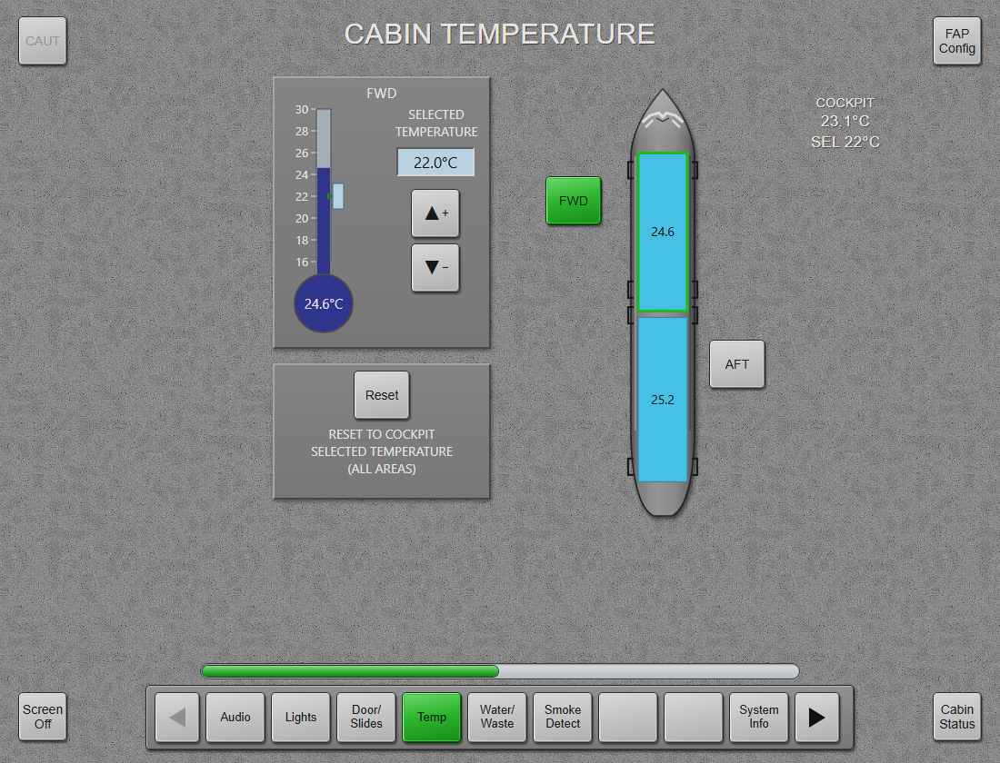
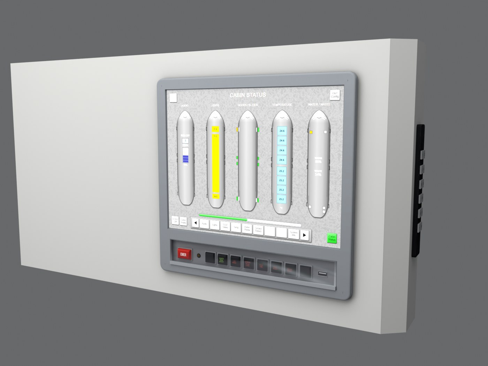
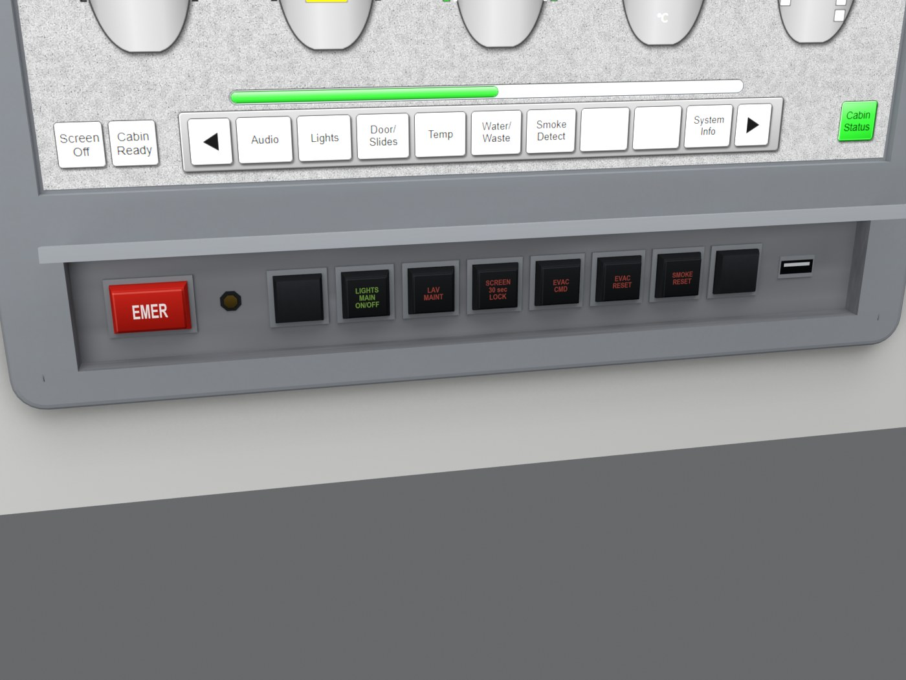

# ToLiss FAP: Flight Attendant Panel for the ToLiss A320 and A321

A working Airbus CIDS **Flight Attendant Panel** for the ToLiss A320 and A321 in X-Plane 12.
It sits on the forward-entry wall behind the cockpit. You can click it in 3D or open it as a popup or a separate window.

> [!NOTE]
> This is a free community add-on. It is **not affiliated with ToLiss or Airbus**.
> No ToLiss files are shipped. The installer patches the copy on your own machine and always makes backups first.

**Video:** coming soon.

## Features

- **CIDS-style touch screen**, built with X-Plane 12's browser avionics (HTML/JS rendered by X-Plane's built-in browser and driven by a C++ plugin):
  - Cabin Status overview
  - Cabin Lighting
  - Doors / Slides
  - Temperature
  - Water / Waste
  - Smoke Detection
  - Audio
  - Calls
  - Evacuation
  - System Info
  - FAP Config
  - Caution list
- **Hooked into the ToLiss systems:**
  - Door modes (Close / Auto / Open), including cargo doors
  - A321 exit configurations (classic 4 doors and the three "Cabin Flex" overwing-exit layouts): the Doors page shows the doors and exits of the current configuration
  - Cabin light level
  - Forward and aft cabin temperature (the cockpit knobs move with it)
  - The **Cabin Ready** button (Cabin Status page) raises *CABIN READY* on the ECAM.
  - Cockpit purser and EMER CALL buttons show up on the Calls page. ToLiss plays its own chime, so there is no double ding.
  - Cockpit door: the door keypad works with the pedestal COCKPIT DOOR switch (see below).
- **Audio:**
  - Boarding music with channels and volume
  - Real A320 chimes: hi, lo, hi-lo and tri-tone
  - Prerecorded announcements in a folder tree, with a MEMO queue, Play Next and Play All (the key stays lit while it plays)
  - `.wav` and `.mp3`. Multi-language sets like `08_after_landing/after_landing_en.mp3` are shown as "08 After landing > English".
  - Cabin PA is quieter in the cockpit and depends on whether the cockpit door is open.
- **Realistic power-up:**
  - The keys are backlit as soon as the batteries are on.
  - The screen needs AC power (ground power, APU or engines) and runs a ~30 s CIDS start-up sequence first.
  - A short power transfer (GPU to APU) does not restart it, and a flight that starts with power already on skips the start-up.
- **3D panel hardware**:
  - Metal bezel set into the ToLiss FAP housing: 2K textures with CC0 surface grain and baked ambient occlusion
  - Black keys with colour-backlit legends (brighter or blinking when active): EMER, LIGHTS MAIN ON/OFF, LAV MAINT, SCREEN LOCK, EVAC CMD/RESET, SMOKE RESET
  - Clear cover over the keys that lifts from the top: open it before you can press them
  - USB port
  - **Flight-deck door keypad** on the right side of the housing, facing the cockpit door:
    1. Type a code and press `#`. It beeps in the cockpit for 5 s.
    2. If the pedestal COCKPIT DOOR switch is in NORM, the door then unlocks for 5 s.
    3. LOCK during the beeps denies entry.
  - Night lighting matched to the ToLiss cabin
  - Screen brightness follows the ambient light.
- **Per-livery content:** a livery can bring its own boarding music, announcements and screen-off image (see [LIVERY_FAP.txt](LIVERY_FAP.txt)).
- **Responsive:** the page only redraws what changed, and quick repeated presses are never dropped.
- **Plugins menu:**
  - Show/hide the popup
  - Pop out into its own window (second monitor)
  - Rescan sounds (also the chimes and the current livery's content)
  - Reload the page

| | |
|---|---|
|  |  |
|  |  |
|  |  |
|  |  |
|  |  |

## Install

**Just want to fly?** Read the [User Guide](docs/USER_GUIDE.md). In short:

1. Download the latest zip from [Releases](../../releases).
2. Close X-Plane.
3. Unzip the download.
4. Double-click **`Install FAP.bat`**. If you have both the A320 and the A321, it asks which ones (Enter = both).

**Requirements:**
- Windows 10/11
- X-Plane **12.4+** (needed for the browser avionics API)
- ToLiss A320 (Neo) and/or ToLiss A321 (Neo/LR). The installer finds both and asks which ones to install into.

**After every ToLiss update,** run the installer again. ToLiss updates replace the cockpit object and the `.acf`.

**To uninstall,** run `Uninstall FAP.bat`. It restores the original cockpit object and `.acf` attachments.

The installer patches both the HD (`a32x.acf`) and the StdDef (`a32x_StdDef.acf`) variants. The `_XP11` variants are left alone. Re-running it never overwrites sounds you added or replaced.

## How it works

| Piece | What it does |
|---|---|
| `src/fap.cpp` | X-Plane plugin. Creates a browser avionics device (`XPLMCreateAvionicsEx`, `xplm_WindowContentTypeBrowser`) that loads `html/index.html`. It exposes `xplane.getState` / `xplane.action` to the page, reads and writes the ToLiss datarefs, and runs the commands, chimes and sound playback. |
| `src/audio.cpp` | Small WAV/MP3 player on top of X-Plane's FMOD sound API (`XPLMSound`), plus the synthesized door-keypad beeps. |
| `html/index.html` | The whole FAP UI: one self-contained page with no external dependencies. Open it in a desktop browser to preview it with demo data. |
| `obj/fap_screen.obj` | Screen surface (`ATTR_cockpit_device`) and click zones. In X-Plane only the cockpit object receives clicks, so the installer appends this to your local ToLiss cockpit OBJ. The original is kept as `*.fap-original`. |
| `obj/fap_hw.*` | Our own 3D model of the panel hardware (bezel, keys, key cover, door keypad) with albedo, LIT and normal textures, attached as an extra object in the `.acf`. Generated from code by the scripts in `tools/`. |
| `installer/Install-FAP.ps1` | Install, update and uninstall for the A320 and A321. Plain Windows PowerShell 5.1 with nothing else to install. Every file it touches gets a timestamped `.fapbak-*` backup. |

Commands, datarefs, the build and the asset pipeline are covered in [docs/DEVELOPMENT.md](docs/DEVELOPMENT.md).

## Adding sounds

Supported audio is `.wav` or `.mp3`.

- **Your own sounds:** drop the files into `plugins/ToLissFAP/sounds/music` or `sounds/announcements`.
- **Per-livery content:** see [LIVERY_FAP.txt](LIVERY_FAP.txt).
- **Livery painters:** you are welcome to ship a `FAP/` folder with your livery.

## Contributing

Issues and pull requests are welcome. These would help most:
- A319 support (the installer and plugin should mostly work already, untested)
- macOS and Linux builds
- Photos and documentation of the real CIDS FAP pages and keys
- More pages and system hooks
- Translations

## License

- **Code, UI and 3D model:** [GPL-3.0-or-later](LICENSE).
- **Shipped audio:** public domain / CC0. Details in [sounds/CREDITS.txt](sounds/CREDITS.txt).
- **Texture grain:** derived from CC0 material scans by [ambientCG](https://ambientcg.com) (Plastic006, Plastic010, Plastic011).
- **MP3 decoder:** [minimp3](https://github.com/lieff/minimp3), CC0, in `third_party/minimp3`.
- **X-Plane SDK headers and libraries** in `sdk/`: their own permissive license ([sdk/license.txt](sdk/license.txt)).
- **Trademarks:** ToLiss, Airbus and X-Plane belong to their owners and are used here only to describe compatibility.
